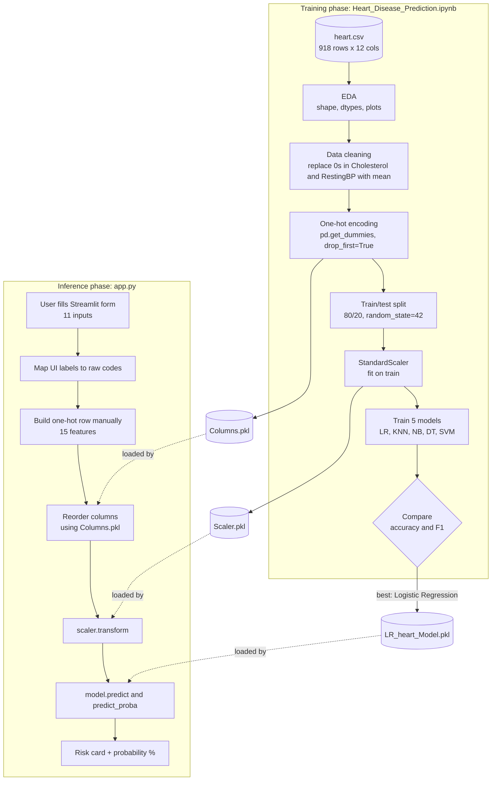

# ❤️ Heart Disease Predictor — Clinical ML Interface

An interactive **Streamlit web app** that predicts a patient's risk of heart disease from 11 clinical features, powered by a **Logistic Regression** model trained on the UCI Heart Failure Prediction dataset.

**Repository:** https://github.com/fadifadifadifadifadi157-glitch/Heart-Disease-Predictor--Clinical-ML-Interface

---

## 📋 Table of Contents

- [Overview](#-overview)
- [Demo Preview](#-demo-preview)
- [Dataset](#-dataset)
- [Project Architecture](#-project-architecture)
- [Methodology](#-methodology)
- [Model Performance](#-model-performance)
- [Installation](#-installation)
- [Usage](#-usage)
- [How the Prediction Pipeline Works](#-how-the-prediction-pipeline-works)
- [Tech Stack](#-tech-stack)
- [Disclaimer](#-disclaimer)

---

## 🔍 Overview

This project takes a patient's clinical measurements (age, blood pressure, cholesterol, ECG results, etc.) and predicts whether they are at **high** or **low** risk of heart disease, along with a probability score. It consists of two parts:

1. **`Heart_Disease_Prediction.ipynb`** — the data science notebook: exploratory data analysis (EDA), data cleaning, encoding, model training/comparison, and exporting the final model artifacts.
2. **`app.py`** — a polished Streamlit front-end that loads those saved artifacts and serves real-time predictions through a form-based UI.

---

## 🖼 Demo Preview

The app features a dark gradient theme with three input sections (Personal Details, Clinical Measurements, Cardiac Symptoms & Tests), an animated result card (⚠️ High Risk / ✅ Low Risk) with the predicted probability, and an expandable debug view of the exact model input.

---

## 📊 Dataset

The model is trained on `heart.csv` — **918 patient records, 12 columns** (11 features + 1 target):

| Column | Description | Type |
|---|---|---|
| `Age` | Patient's age in years | Numerical |
| `Sex` | M = Male, F = Female | Categorical |
| `ChestPainType` | TA, ATA, NAP, ASY | Categorical |
| `RestingBP` | Resting blood pressure (mm Hg) | Numerical |
| `Cholesterol` | Serum cholesterol (mm/dl) | Numerical |
| `FastingBS` | 1 if fasting blood sugar > 120 mg/dl, else 0 | Binary |
| `RestingECG` | Normal, ST, LVH | Categorical |
| `MaxHR` | Maximum heart rate achieved | Numerical |
| `ExerciseAngina` | Y/N — exercise-induced angina | Categorical |
| `Oldpeak` | ST depression induced by exercise | Numerical |
| `ST_Slope` | Up, Flat, Down | Categorical |
| `HeartDisease` | **Target** — 1 = disease, 0 = normal | Binary |

---

## 🏗 Project Architecture

```
Heart-Disease-Predictor--Clinical-ML-Interface/
│
├── app.py                  # Streamlit front-end (loads artifacts, serves predictions)
├── Heart_Disease_Prediction.ipynb           # EDA + preprocessing + model training notebook
├── heart.csv                 # Source dataset (918 rows × 12 columns)
│
├── LR_heart_Model.pkl       # Trained Logistic Regression model (joblib)
├── Scaler.pkl                # Fitted StandardScaler used at training time
├── Columns.pkl                # Exact one-hot encoded column order the model expects
│
├── requirements.txt         # Python dependencies
└── README.md                 # Project documentation (this file)
```

### Data flow



<details>
<summary>Plain-text version</summary>

```
heart.csv
   │
   ▼
[Heart_Disease_Prediction.ipynb]  →  EDA → cleaning → one-hot encoding → train/test split
   │                 → scaling (StandardScaler) → train 5 models → compare
   ▼
LR_heart_Model.pkl + Scaler.pkl + Columns.pkl   (saved artifacts)
   │
   ▼
[app.py]  →  loads artifacts → user fills form → builds encoded row
   │         → scales row → model.predict_proba() → shows risk + probability
   ▼
 Browser UI (Streamlit, http://localhost:8501)
```

</details>

---

## 🧪 Methodology

The notebook (`Heart_Disease_Prediction.ipynb`) follows this pipeline:

1. **EDA**
   - Shape, dtypes, duplicate check, missing-value check
   - Distribution plots (histograms) for numerical features
   - Count plots for categorical features split by `HeartDisease`
   - Box/violin plots comparing numerical features across the target
   - Correlation heatmap

2. **Data Cleaning**
   - `Cholesterol` and `RestingBP` contain invalid `0` values (physiologically impossible) — replaced with the **mean of non-zero values** in each column.

3. **Encoding**
   - `pd.get_dummies(df, drop_first=True)` applied to the full dataset, turning categorical columns into one-hot encoded binary columns (dropping the first alphabetical category per feature to avoid multicollinearity).

4. **Train/Test Split**
   - 80/20 split, `random_state=42`.

5. **Feature Scaling**
   - `StandardScaler` fit on the training set.

6. **Model Comparison**
   Five classifiers were trained and evaluated on Accuracy and F1 Score:
   - Logistic Regression
   - K-Nearest Neighbors
   - Gaussian Naive Bayes
   - Decision Tree
   - Support Vector Machine (SVC)

7. **Model Export**
   - The best-performing model (**Logistic Regression**) was saved with `joblib`, alongside the fitted scaler and the exact training column order — all three are required at inference time.

---

## 📈 Model Performance

Evaluated on the 20% hold-out test set (184 patients, `random_state=42`):

| Model | Accuracy | F1 Score |
|---|---|---|
| **Logistic Regression** ✅ (deployed) | **86.96%** | **0.8846** |
| KNN | 86.41% | 0.8815 |
| SVM | 84.78% | 0.8667 |
| Naive Bayes | 84.78% | 0.8614 |
| Decision Tree | 79.35% | 0.8119 |

Logistic Regression scored highest on both metrics, and it is also fast, interpretable, and gives calibrated probabilities, which makes it a good fit for a risk-score app.

---

## ⚙️ Installation

1. **Clone the repository**
   ```bash
   git clone https://github.com/fadifadifadifadifadi157-glitch/Heart-Disease-Predictor--Clinical-ML-Interface.git
   cd Heart-Disease-Predictor--Clinical-ML-Interface
   ```

2. **Install dependencies**
   ```bash
   pip install -r requirements.txt
   ```
   Dependencies: `streamlit`, `pandas`, `numpy`, `scikit-learn`, `joblib`

---

## ▶️ Usage

Make sure `app.py`, `LR_heart_Model.pkl`, `Scaler.pkl`, and `Columns.pkl` are all in the same folder, then run:

```bash
streamlit run app.py
```

Your browser will open automatically at **http://localhost:8501**. Fill in the patient's details across the three sections and click **🔍 Predict Heart Disease Risk** to see the result.

---

## 🧠 How the Prediction Pipeline Works

The app reproduces the notebook's exact preprocessing logic for a single live input, which requires care because `pd.get_dummies(drop_first=True)` behaves differently on a full dataset versus a single row.

**Why this matters:** `drop_first=True` needs to see *every* category in a column to know which one to drop. Applied to a one-row DataFrame (a single form submission), it would only see one category per column and could silently zero out valid information.

**The fix:** `app.py` manually reconstructs the same one-hot columns the model was trained on, using the same "drop first alphabetical category" rule pandas applied during training:

| Feature | Dropped category | Columns kept |
|---|---|---|
| `Sex` | F | `Sex_M` |
| `ChestPainType` | ASY | `ChestPainType_ATA`, `ChestPainType_NAP`, `ChestPainType_TA` |
| `RestingECG` | LVH | `RestingECG_Normal`, `RestingECG_ST` |
| `ExerciseAngina` | N | `ExerciseAngina_Y` |
| `ST_Slope` | Down | `ST_Slope_Flat`, `ST_Slope_Up` |

The row is then ordered using `Columns.pkl`, scaled with the saved `Scaler.pkl`, and passed to `LR_heart_Model.pkl` — with no retraining and no change to the original model weights or thresholds.

```
Form input → map UI labels to raw codes → build one-hot row (manual, matches training)
           → reorder columns via Columns.pkl → scaler.transform() → model.predict_proba()
           → display risk card + probability
```

---

## 🛠 Tech Stack

- **Python 3**
- **scikit-learn** — model training (`LogisticRegression`, `StandardScaler`)
- **pandas / numpy** — data manipulation
- **joblib** — model/scaler/column persistence
- **Streamlit** — interactive web UI
- **seaborn / matplotlib** — EDA visualizations (notebook only)

---

## ⚠️ Disclaimer

This tool is built for **educational and portfolio purposes only**. It is **not a medical device** and must not be used as a substitute for professional medical diagnosis, advice, or treatment. Always consult a qualified healthcare provider for any medical concerns.
